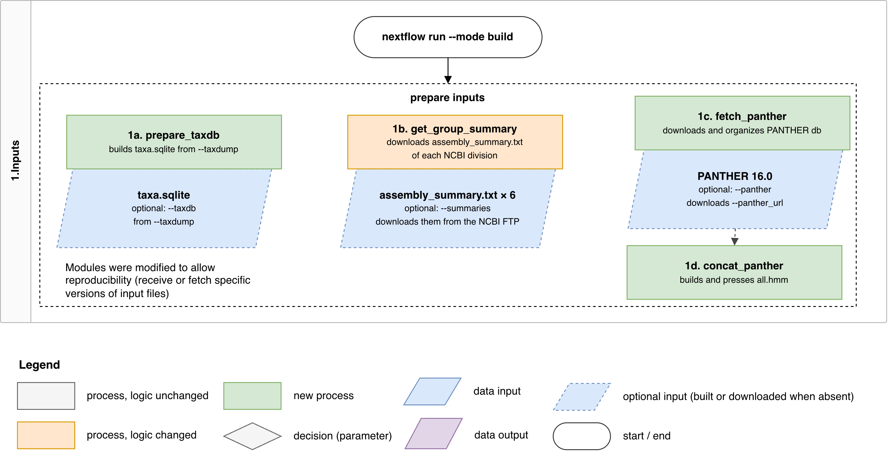
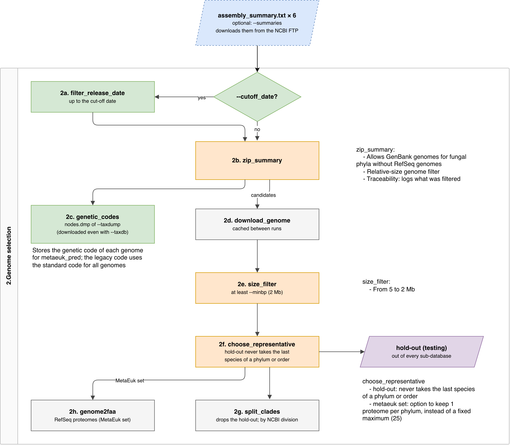
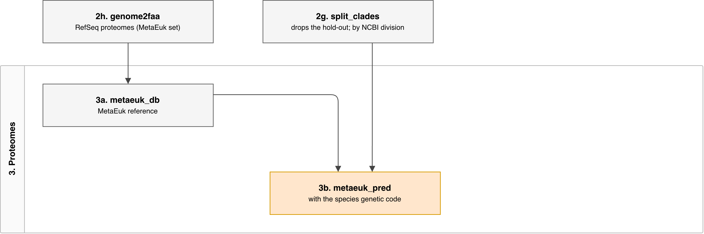
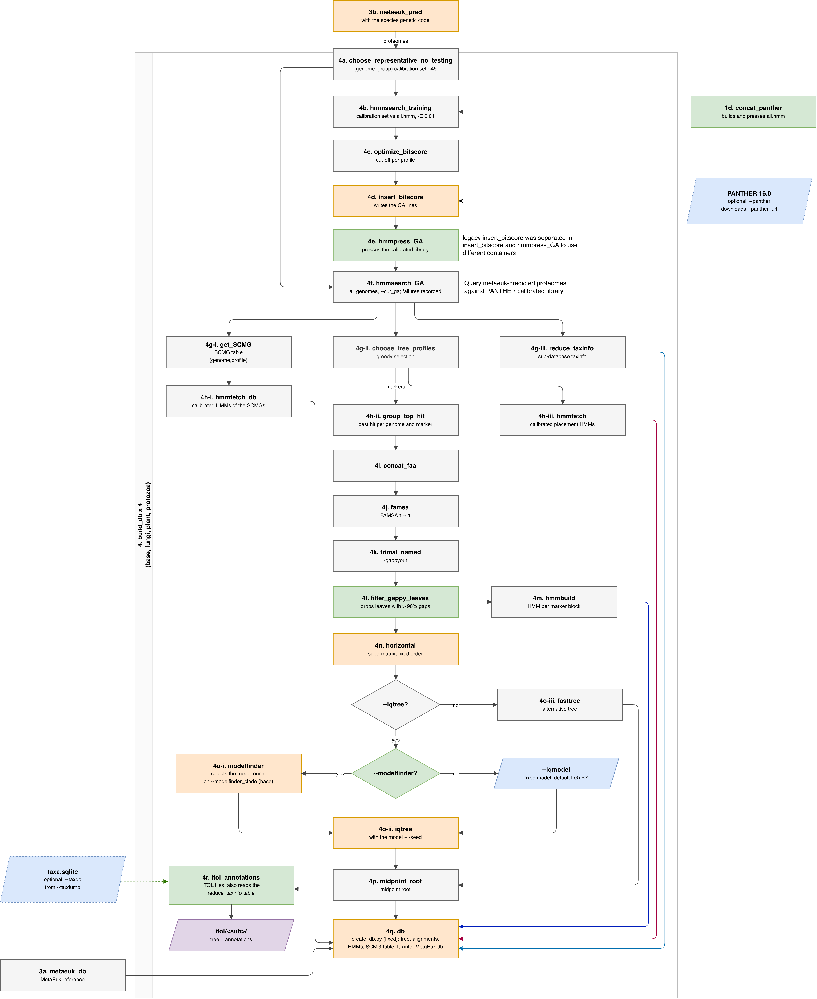
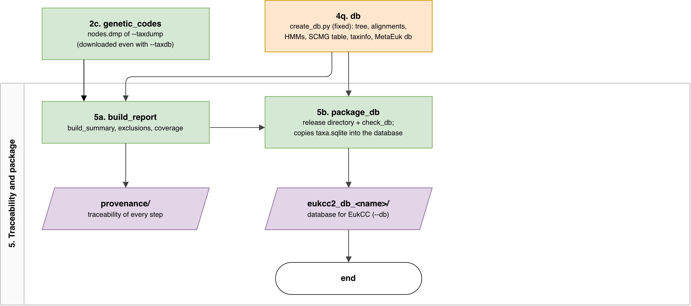

# Workflow steps

This page describes the main steps of the workflow that builds the EukCC database, and
documents what was kept "as is" from the legacy code and what was modified or added.

The complete diagram is
[available here](https://drive.google.com/file/d/1k7In2QvsM44QEqNkg0JLmIhfcQ5DkuXm/view?usp=sharing)
and can be opened on [app.diagrams.net](https://app.diagrams.net/). Here it is split into
five parts:

1. [Inputs](#1-inputs)
2. [Genome selection](#2-genome-selection)
3. [Proteomes](#3-proteomes)
4. [Build db](#4-build-db)
5. [Traceability](#5-traceability)

Step 4 runs once for `base` (every genome) and once for each sub-database (`fungi`,
`plant`, `protozoa`). In the file names below, `` stands for one of them.

---

## 1. Inputs

The three inputs can be given to the workflow or fetched by it. Giving a fixed version of
each one is what makes a build reproducible.

  

- **1a. `prepare_taxdb`:** builds the taxonomy database `taxa.sqlite` from an NCBI taxonomy
  dump (`--taxdump`: the dump of the day, or a monthly snapshot from the NCBI archive).
  This step is skipped when the user gives a ready `taxa.sqlite` (`--taxdb`). The taxonomy
  is used in several steps below, and it ships inside the database.
- **1b. `get_group_summary`:** downloads the `assembly_summary.txt` of each NCBI division
  (fungi, plant and protozoa, from RefSeq and GenBank: 6 files in total). These tables
  list every genome assembly NCBI has. This step is skipped when the user gives the files
  (`--summaries`), which allows a version of the database to be reproduced.
- **1c. `fetch_panther`:** downloads the PANTHER 16.0 library of protein family profiles
  (HMMs). This step is skipped when the user gives a local copy (`--panther`).
- **1d. `concat_panther`:** joins all PANTHER family profiles into one file, `all.hmm`, and
  indexes it for `hmmsearch`. It is used to calibrate the bit score cut-offs (step 4b).

## 2. Genome selection

In this step, the genomes that will compose the training dataset and that will be used in
the database are selected.

  

- **2a. `filter_release_date`:** runs only when the user gives a cut-off date
  (`--cutoff_date`) and keeps the genomes released up to that date. The
  `assembly_summary.txt` files describe NCBI on the day they are downloaded, so this step
  removes the genomes released after a given date, which helps reproducibility.
- **2b. `zip_summary`:** turns the 6 tables into one list of candidate genomes, with one
  genome per species. It keeps only reference genomes that are complete, and it prefers
  the RefSeq genome of a species over the GenBank one (logic from the legacy code, also
  described in Paul Saary's thesis).
  - For fungi, the logic was modified: GenBank genomes are allowed only for phyla without
    any RefSeq genome (see [Table 1](#table-1)).
  - Land plants (Embryophyta) and animals are removed, so `plant` holds the algae.
  - Finally, it drops genomes much smaller than their relatives (less than 10% of the
    median size of the genus), which are usually partial assemblies.
  - Not in the legacy code: before one genome per species is chosen, it drops the
    accessions listed in `--exclude_genomes` (`assets/exclude_genomes.tsv`), bad reference
    genomes found by hand (e.g. `GCA_040437675.1`, an almost fully duplicated
    *Halimeda opuntia* assembly). Another assembly of the same species can still enter.
    The list is copied to `provenance/exclude_genomes.tsv`, and each accession gets a row in
    `exclusions.tsv` (with a warning if no NCBI summary has it).

  The number of genomes removed by each filter goes to `provenance/build_summary.tsv`.
- **2c. `genetic_codes`:** reads the genetic code of each candidate species from the
  taxonomy dump. It is used only in the report: `coverage.tsv` counts the genomes with a
  non-standard code, which 3b still translates with the standard one.
- **2d. `download_genome`:** downloads the genome sequence of each candidate. The genomes
  are kept in a cache and reused between runs.
- **2e. `size_filter`:** drops genomes smaller than 2 Mb, just below the smallest known
  nuclear genomes (Microsporidia). The legacy workflow used 5 Mb, which removed most
  Microsporidia.
- **2f. `choose_representative`:** gives two roles to the genomes:
  - **hold-out:** about 30 RefSeq species, one per phylum at a time, are kept out of every
    sub-database. They are used later to test the database (`--mode testing`). In the
    legacy code, the hold-out could take the last species of a phylum, and the lineage
    disappeared from the database. Now the hold-out never takes the last species of a
    phylum or order, so no lineage disappears from the database because of it.
  - **MetaEuk set:** RefSeq species whose annotated proteomes form the MetaEuk reference
    (2h, 3a). About 25 species, taken one per phylum per round, as in the legacy workflow.
    The size is checked only after each full round, so every phylum with a RefSeq genome
    gets one species and the set can be larger than 25. Every annotated protein of these
    proteomes goes into the MetaEuk database, with no clustering. Hold-out species never
    enter the MetaEuk set, and the MetaEuk species are also leaves of the tree.
- **2g. (no process, was `split_clades`):** removes the hold-out genomes and keeps the
  NCBI division (fungi, plant, protozoa) of the rest. The genomes keep their path from
  2e instead of being copied, and each sub-database in step 4 reads only its own rows of
  the candidate table. A genome added to `--exclude_genomes` in one division therefore
  reruns, with `-resume`, only that sub-database and `base`.
- **2h. `genome2faa`:** downloads the annotated RefSeq proteomes of the MetaEuk set.

**Table 1.** Fungal species with a reference genome, by phylum, in NCBI RefSeq and only in
GenBank (NCBI on 2026-10-15). Bold: phyla without any RefSeq genome, whose GenBank genomes
enter the database (46 in total).

| Phylum                 | RefSeq | Only GenBank |
|:-----------------------|-------:|-------------:|
| Ascomycota             |    520 |        3,452 |
| Basidiomycota          |    106 |        1,166 |
| Mucoromycota           |     14 |           82 |
| Microsporidia          |     17 |           39 |
| Kickxellomycota        |      2 |           39 |
| Chytridiomycota        |      5 |           36 |
| Mortierellomycota      |      2 |           34 |
| Glomeromycota          |      1 |           26 |
| Calcarisporiellomycota |      1 |            0 |
| Zoopagomycota          |      0 |       **10** |
| Blastocladiomycota     |      0 |        **9** |
| Entomophthoromycota    |      0 |        **8** |
| Neocallimastigomycota  |      0 |        **5** |
| Basidiobolomycota      |      0 |        **3** |
| Aphelidiomycota        |      0 |        **3** |
| Rozellomycota          |      0 |        **2** |
| Sanchytriomycota       |      0 |        **2** |
| Monoblepharomycota     |      0 |        **2** |
| Olpidiomycota          |      0 |        **1** |
| no phylum              |      0 |        **1** |

## 3. Proteomes

In this step, the proteins of every genome are predicted with MetaEuk, against a reference
built from the MetaEuk set. They are used by every search and tree of step 4.

  

- **3a. `metaeuk_db`:** turns the MetaEuk set proteomes into a MetaEuk database. It is used
  to predict the proteins of every genome in 3b, and it ships in `db_base/`, where EukCC
  uses it to predict the MAG proteins.
- **3b. `metaeuk_pred`:** predicts the proteins of every genome left after 2g, with MetaEuk.
  As in the legacy code, every genome is translated with the standard genetic code,
  because EukCC predicts the MAG proteins with it, and the bit score cut-offs (4c) must be
  calibrated on the same kind of proteins. The legacy code silently removed the genomes
  MetaEuk failed to predict proteins for; the updated version records them in
  `exclusions.tsv`.

## 4. Build db

In this step, `base` and each sub-database are built from their genomes: the PANTHER
profiles are calibrated with a bit score cut-off, and the proteins of every genome are
searched against them. These searches give the SCMG table, which EukCC uses to estimate
completeness and contamination, and the placement markers.

  

- **4a. `choose_representative_no_testing` (`genome_group`):** picks about 45 genomes of
  the sub-database (`--calibration_size`, default 45 from the legacy code), balanced by
  phylum, as the calibration set.
- **4b. `hmmsearch_training`:** searches the proteins of the calibration set against all
  PANTHER families (`all.hmm`, from 1d).
- **4c. `optimize_bitscore`:** chooses, for each PANTHER family, the bit score cut-off that
  makes the family appear in a single copy in as many calibration genomes as possible,
  spread across taxonomic groups.
- **4d. `insert_bitscore`:** writes each cut-off into its PANTHER profile as the `GA` line.
  Families with no hit in the calibration set are left out. The result is the calibrated
  library of the sub-database. In the legacy code, 4d and 4e were one module; they are
  split here because the HMMER container has no Python.
- **4e. `hmmpress_GA`:** indexes the calibrated library for `hmmsearch` and `hmmfetch`.

- **4f. `hmmsearch_GA`:** searches the proteins of every genome of the sub-database
  against the calibrated library, keeping only hits above each `GA` cut-off (`--cut_ga`,
  the same search EukCC does on the MAG).
- **4g-i. `get_SCMG`:** for each genome, lists the PANTHER families found in exactly one
  copy. This is the SCMG table (`_SCMGs.csv.gz`).
- **4g-ii. `choose_tree_profiles`:** chooses the placement markers, the families used to
  build the tree and to place a MAG on it. It is a greedy selection: at each round it
  picks the family found in a single copy in the most genomes that are still poorly
  covered, and it penalizes families with many copies.
- **4g-iii. `reduce_taxinfo`:** writes the taxid of each genome of the sub-database
  (`_taxinfo.csv`).
- **4h-i. `hmmfetch_db`:** extracts from the calibrated library the profiles of every
  family in the SCMG table and indexes them (`_PANTHERv16.0.hmm.h3*`). EukCC searches
  the expected SCMGs of a MAG with these profiles.
- **4h-ii. `group_top_hit`:** for each placement marker, takes the best-scoring protein of
  each genome.
- **4h-iii. `hmmfetch`:** extracts the calibrated profiles of the placement markers
  (`_search.hmm`). EukCC uses them to find which MAG proteins are placement markers.

- **4i. `concat_faa`:** joins the proteins of each marker into one file.
- **4j. `famsa`:** aligns the proteins of each marker.
- **4k. `trimal_named`:** removes the gap-rich columns of each alignment.
- **4l. `filter_gappy_leaves`:** drops the genomes that are more than 90% gaps across all
  markers, since they carry almost no information for the tree. The trimmed alignment of
  each marker is a block (`place/<PTHR>.aln`).
- **4m. `hmmbuild`:** builds one HMM from each block (`place/<PTHR>.hmm`). It is not the
  PANTHER profile: it covers only the columns of the block, so EukCC can align the MAG
  proteins exactly onto them.
- **4n. `horizontal`:** concatenates the blocks side by side, in alphabetical order, into
  the supermatrix (`_tree.aln`). EukCC concatenates the MAG blocks in the same order,
  so the columns match.
- **4o-i. `modelfinder`:** chooses the substitution model once, on the `base` supermatrix,
  and every sub-database uses it. When ModelFinder is off, the model is fixed by the user
  (`--iqmodel`, required then; the model of Paul Saary's thesis is `LG+R7`).
- **4o-ii. `iqtree`:** builds the maximum likelihood tree from the supermatrix, with that
  model and a fixed seed.
- **4o-iii. `fasttree`:** alternative to 4o-ii, faster and less accurate
  (`--iqtree false`).
- **4p. `midpoint_root`:** roots the tree at its midpoint (`_rooted.tre`). EukCC
  places the MAG on these rooted trees.

- **4q. `db`:** gathers the files above into `db_/` and writes `db_info.json`, with
  the path of each file and the substitution model, which EukCC passes to `epa-ng` when it
  places the MAG. Only `db_base/` gets the MetaEuk database.
- **4r. `itol_annotations`:** writes iTOL annotation files to check each tree against the
  NCBI taxonomy (`itol//`). They are not part of the database, but they help to
  understand the taxonomy of the generated trees.

## 5. Traceability

The final step writes reports of what composes the database, creates the folder structure
of the database and checks that all expected files are present.

  

- **5a. `build_report`:** writes three tables to `provenance/`: where every candidate
  genome was removed and why (`exclusions.tsv`), how many genomes passed each step
  (`build_summary.tsv`), and which groups (fungi, plant, protozoa) and phyla each
  sub-database covers (`coverage.tsv`).
- **5b. `package_db`:** builds the release directory `eukcc2_db_<name>/`, the folder given
  to EukCC with `--db`. It holds the four sub-databases, the `taxa.sqlite` from 1a
  (`etetoolkit/`) and the provenance of the build. Before finishing, it checks the
  structure of every sub-database (for example, that the blocks add up to the supermatrix
  and that every placement profile has a `GA` line), and the run fails if a check does not
  pass. Last, `release_readme.py` writes `README.md`: the version (`YYYY_MM` of
  `--cutoff_date`, otherwise of the day the run started), where each input came from (NCBI
  summaries with their md5, the taxonomy dump with its md5 and date, PANTHER), the main
  parameters, tool versions, the counts of each sub-database and the command to rebuild it.
  Example: `docs/release_example/README.md`.
